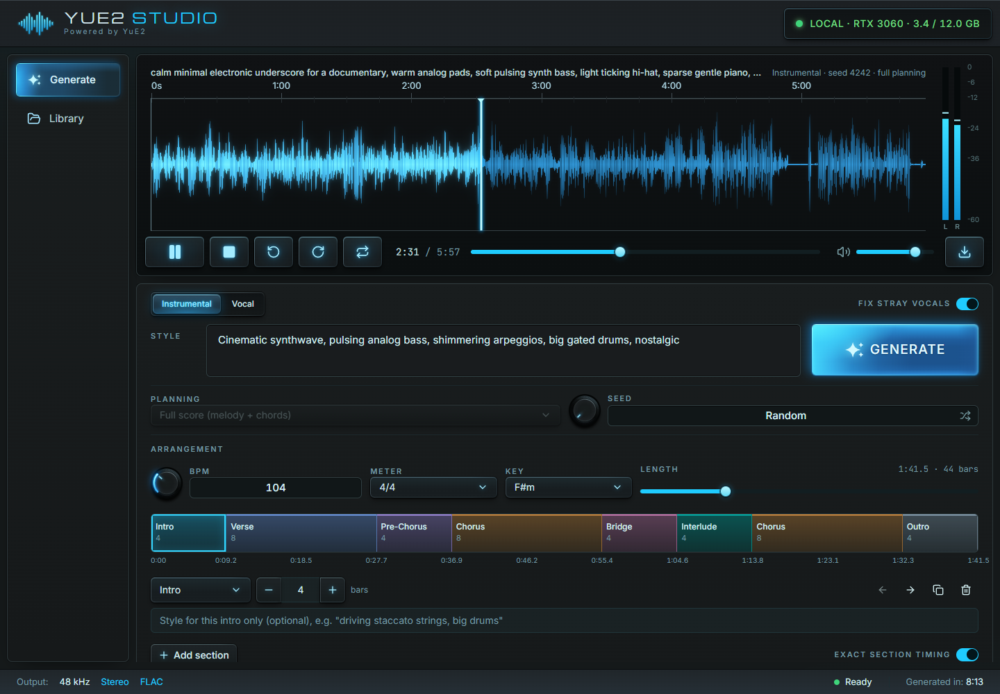

# YuE2 Studio

A small local web UI for [YuE2](https://github.com/multimodal-art-projection/YuE) (M-A-P's lyrics + style → full-song model), tuned to run on a 12 GB RTX 3060 under Windows 11.



## Install

Requires Python 3.12 (with the `py` launcher), Node.js, and an NVIDIA GPU. [Import from audio](#covers) also needs FFmpeg on `PATH` (`winget install Gyan.FFmpeg`).

Double-click **`Install.cmd`**. Double-clicking **`YuE2 Studio.exe`** works too; on first run it offers to install. The installer does the following:

- Creates `.venv` with Python 3.12, PyTorch 2.10 (CUDA 12.8), `yue2-infer` 0.1.6 and Demucs.
- Downloads the weights (~7.8 GB, plus ~410 MB for the [vocal check](#stray-vocals)) into `models\`.
- For [Import from audio](#covers): creates `.venv-sheetsage2` with Python 3.11 and PyTorch 2.8 (CUDA 12.6), about 7 GB, and downloads SheetSage2 and its MERT-v2 encoder (~2.8 GB) into `models\`. If Python 3.11 is missing, the Python install manager (`py install 3.11`) adds it.
- Builds the web app and compiles `YuE2 Studio.exe` (icon included) with the C# compiler that ships with Windows.
- Adds **YuE2 Studio** to the Start menu.

To pin it, open Start, find **YuE2 Studio**, right-click it, and choose **Pin to Start** or **Pin to taskbar**. Re-running the installer is safe. Add `-Desktop` (`Install.cmd -Desktop`) to also get a desktop shortcut.

`Uninstall.cmd` removes the shortcuts but leaves your songs and the models in place. To remove everything, delete the folder afterwards.

## Running

Launch **YuE2 Studio** from the Start menu. `YuE2 Studio.exe` runs `scripts\launch.pyw`. That starts the backend on `127.0.0.1:7862` with no console window, then opens the app in a chromeless Edge or Chrome window. Closing the window stops the backend after about 20 seconds. If no window ever connects, it stops after 3 minutes. MCP clients keep it running too (see below). Logs go to `logs\backend.log`.

Songs are saved to `outputs\<timestamp>-<id>\`. Each folder has `audio.flac` (48 kHz stereo), `score.abc` (the generated melody and chord plan), and the full YuE2 artifact set.

## The studio

- **Player.** It stays above both views, so a song keeps playing while you work. Click or drag the waveform to seek. Space plays and pauses, and the meter on the right shows the left and right levels.
- **Generate.** Choose Instrumental or Vocal, describe the style, and lay out the song. **Generate** (or Ctrl+Enter in the style box) shows its progress and becomes the cancel button while a song runs. The latest four songs are below the form.
- **Library.** Every song, with its waveform. The ⋮ menu loads a song's settings back into the form, downloads its MP3, FLAC or score, or deletes it.
- **Knobs.** Drag up or down (hold Shift for fine control) or scroll to change a value, double-click to reset it to its default where it has one, or type in the box beside it.

The status bar shows the current job, and the pill in the title bar shows the GPU and its VRAM use.

## Parameters

| UI | YuE2 | Notes |
|---|---|---|
| Style | `style` | Genre, mood, instruments, vocal type. |
| Lyrics | `lyrics` | Use section tags like `[Verse]`, `[Chorus]`, `[Bridge]`, `[Outro]`. |
| Instrumental / Vocal | (see below) | Instrumental: no lyrics, and you lay the song out on the timeline. |
| Fix stray vocals | (see [below](#stray-vocals)) | Instrumentals: listen for singing and re-render the part that has it. On by default. |
| Timeline | (see below) | BPM, meter (4/4 or 3/4), key, and labeled sections in whole bars. Sets the exact length. |
| Key | (see [below](#key)) | Auto, or a major/minor key for the planned score. In the timeline for instrumentals, next to Planning for songs with lyrics. |
| Max length | `semantic_sampling.max_tokens` (25 tokens/s) | Songs with lyrics: length follows the lyrics, and this only caps it (max 6:00). |
| Planning | `cot` | `full`: melody + chords score first (default). `melody`: melody only. `off`: no score. |
| Seed | `seed` | Random by default. The button beside the value locks a seed or goes back to random. |
| Guidance | `cfg_scale` | Auto = model default. Values above 1 run a second branch. |
| Temperature / Top-p / Top-k / Repetition | `semantic_sampling.*` | Song-token sampling. Repetition is the repetition penalty. |
| Flow steps | `GenerationConfig.ode_steps` | Acoustic flow-matching steps (default 32). |
| Score (ABC) | `abc` | Supply or edit a score, e.g. one downloaded from an earlier song. |
| Import from audio | `abc` + `cot="melody"` | Transcribes a recording's melody into Score with SheetSage2 for a [cover](#covers), and sets Planning to Melody only. |

## Instrumentals on a timeline

In Instrumental mode you set the BPM, the meter, the key, and a row of sections (intro, verse, pre-chorus, chorus, bridge, interlude, instrumental, outro, silence), each a whole number of bars and each with its own color. You can drag a section's right edge, use −/+ or type the bar count, move sections, duplicate or delete them, or drag **Length** to rescale all sections to fit. The length is always exactly bars × beats ÷ BPM.

YuE2 still composes the score; `backend/timeline.py` keeps it on the timeline:

- **Header:** it is written from your BPM, meter and [key](#key). YuE2 picks the note unit, and the key too when **Key** is Auto.
- **Sections:** each label is placed at its first bar. Lines of music are cut at section boundaries, and the instrument line is held to the vocal line's bar count. Lines may only start with music (no meter or key changes).
- **Silence:** silence sections are written as full-bar rests without chords. Because YuE2 renders rests as quiet rather than silent, those bars are also muted in the audio.
- **Repairs:** ties into rests are removed. If a planned score still fails validation, it is re-planned with the next seed (up to 3 times).

Then the melody moves to the instrument voice. Your labels shape the composition, but the audio is rendered with verse, pre-chorus, chorus and bridge renamed to `instrumental` (see [Stray vocals](#stray-vocals)).

**Exact section timing** (on by default) exists because a single-pass render follows the score's notes but can drift up to about a bar early or late. YuE2 works in two stages: song tokens (25 per second), then audio. With this option, the song tokens are written one section at a time:

- Each section is prompted with its slice of the score: 2 lead-in bars, its own bars, and 1 bar of the next section, so it doesn't wind down.
- It continues from the tokens already written for those lead-in bars, and is held to exactly its length.
- A section's own style text is added to the global style while its tokens are written.

The whole token stream is then turned into audio in one pass, so there are no joins in the audio. `meta.json` has a per-section report. Turn the option off for a plain single-pass render. The audio is exactly the timeline's length either way.

## Key

Left to itself, YuE2 almost always plans in E or A minor over the same i–VI–VII chords (Em–C–D, Am–F–G), whatever the style asks for, so songs end up sounding alike. **Key** sets the planned score's `K:` line instead (`backend/keys.py`); YuE2 still writes the melody and chords, in that key. Auto leaves the choice to YuE2.

- **Timeline instrumentals:** the key is forced with the rest of the header.
- **Songs with lyrics, and instrumentals fitted to a length:** YuE2 writes its header as usual and the key is filled in once it reaches `K:`. For songs with lyrics this plan is then given to YuE2 as the song's score, the same as a pasted one.
- **Not with a pasted score** (its `K:` line sets the key) or with Planning off (there is no score); the picker is disabled then.

Over the API and MCP, `key` takes `A`, `Em`, `Bb`, `F#m`, `C major`, `d minor` and so on, up to 7 sharps or flats. A timeline's own `key` works too; if both are given they must agree.

## Instrumentals from a pasted score

With a score in **Advanced → Score (ABC)**, the timeline is replaced by a **Length** knob. `backend/fitted.py` fits the score to that length. Without a score or timeline (API only), it also steers YuE2's own free-running plan to the length:

1. **Planning.** YuE2 writes the score with its own sampler (in the requested [key](#key), if any). Once it has chosen tempo and meter, the target length becomes a bar count. The score can't end early, an `% outro` section is forced near the end (no `% silence` sections, no new sections after the outro), and the score closes at the target bar.
2. **Tempo fit.** The `Q:` tempo is adjusted (at most ±15%, usually a few %) so the score's nominal length equals the target.
3. **Instrumental conversion.** This follows YuE2's official instrumental recipe: the planned melody moves from the Vocal voice to the Ins voice (vendored MIT tools in `backend/vendor/yue2_instrumental`). The song is rendered with section tags instead of lyrics (sung sections as `[Instrumental]`), and the style gets "Instrumental, …, no vocals, no singing, no choir, no spoken words".
4. **Exact audio.** Song tokens are capped at the target and can't stop more than 1 s early. The file is then trimmed (with a 1.5 s fade if the cap cut it) or padded to the exact length.

Each song folder also keeps the untouched model plan as `score-planned.abc`. `meta.json` records the plan and fit numbers.

## Covers

YuE2 can't listen to a recording, because its audio tokenizer isn't released. A cover therefore goes through a score, following upstream's [cover guide](https://github.com/multimodal-art-projection/YuE/blob/yue2-v0.1.6/docs/covers.md):

1. **Advanced → Import from audio.** Pick a recording in any format FFmpeg reads, up to 200 MB. Only the first 6:00 is used, YuE2's longest song. [SheetSage2](https://huggingface.co/m-a-p/SheetSage2) transcribes the melody to ABC. It keeps the vocal and instrument melody lines and leaves out chord symbols.
2. The score fills **Score (ABC)**. **Planning** switches to **Melody only**, so YuE2 keeps the tune but writes its own harmony and accompaniment for the new style. **Length** is set to the recording's.
3. Add a style. For a sung cover, switch to **Vocal** and write lyrics whose sections and syllables follow the melody. For an instrumental cover, stay on **Instrumental**: the melody moves to the instrument voice, as with [a pasted score](#instrumentals-from-a-pasted-score).
4. Generate.

Transcription mistakes carry into the cover, so read through the score, or listen to the source and compare, before a long render. A melody SheetSage2 hears as an instrument lands in the `Ins` voice and the `Vocal` voice is left as rests. For a sung cover of an instrumental recording, move those notes to `Vocal` by hand.

How it runs:

- SheetSage2 pins PyTorch 2.8 and Transformers 4.45, so it lives in its own `.venv-sheetsage2`. `backend/transcribe.py` runs `backend/sheetsage2_worker.py` there as a subprocess, offline, with the weights in `models\SheetSage2` and `models\MERT-v2-FullSong`.
- A transcription takes the same job slot as a song, so the two never share the GPU. It can't start while a song is generating, and songs (including MCP requests) wait for it. YuE2's weights stay in system RAM in the meantime.
- On the RTX 3060, a 40 s clip takes about 15 s (7 s of it loading), and a 6:00 song about 40 s. PyTorch peaks at 3.3 GiB of VRAM. Recordings over 5:00 are transcribed in two overlapping windows.
- Each import keeps SheetSage2's output (`score.abc`, MIDI, beat, key and structure annotations) in `imports\<timestamp>-<id>\`. The uploaded copy of the recording is deleted.

## Stray vocals

YuE2 learned from songs, so it sometimes sings over an instrumental anyway. Upstream says the recipe doesn't guarantee no vocals ([YuE#208](https://github.com/multimodal-art-projection/YuE/issues/208)). The main trigger is a sung-section label in the render prompt. Verses, choruses and bridges almost always have vocals in the training songs, even when the score's Vocal voice is all rests.

Every instrumental path therefore renders verse, pre-chorus, chorus and bridge as `instrumental` (`fitted.render_labels`). Planning still uses your labels, and `score-planned.abc` keeps them. In 129 test renders, scored for singing on a Demucs vocal stem with an AudioSet classifier:

- Chorus sections leaked vocals 36% of the time with `[Chorus]` / `% chorus` in the prompt (12 of 33), and 14% with `instrumental` (7 of 50).
- On cinematic and electronic styles, leaks went from 5 of 16 songs to none.
- On top of the relabeling, two other changes made pop and rock worse. Dropping the style's "no vocals…" words leaked in 5 of 12 songs, and adding CFG 1.5 in 4 of 12, against 2 of 12 without either.

Genres that imply a singer, like pop or rock, still leak now and then. **Fix stray vocals** (on by default) catches those:

- **Listening.** `backend/vocal_check.py` splits the finished audio with Demucs and runs the AudioSet AST classifier on the vocal stem in 5 s windows. Neither works alone: AST on the full mix barely reacts to singing, and the vocal stem also picks up flute, violin and synth leads. Songs with real vocals score 0.2–0.6, clean instrumentals 0–0.05, and a section at 0.15 or more counts as sung.
- **Retrying.** The song is rendered again from the first sung section on, with new seeds. With exact section timing, the sections before it are kept. This happens at most twice, and the attempt with the least singing is kept.
- **Cost.** A check takes about 2 s. A retry costs roughly one more render of the rest of the song.

`meta.json` records each attempt's per-section scores under `vocal_check`.

## Use from other apps (MCP)

Other apps can generate songs through YuE2 Studio over the [Model Context Protocol](https://modelcontextprotocol.io). The `generate_song` tool:

- returns a job handle immediately;
- shows a small embedded UI (an [MCP App](https://github.com/modelcontextprotocol/ext-apps)) with live progress and a player, in hosts that support MCP Apps;
- delivers the finished MP3, FLAC and score as MCP resources (`yue2://tracks/<id>/…`), each with its size and sha256.

The flow follows **MCP Micro-UI Jobs**, a small profile defined in [`specs/mcp-micro-ui-jobs/`](specs/mcp-micro-ui-jobs/README.md). That folder is self-contained and includes reference invokers.

To hand integration to another team, give them [`docs/MCP-INTEGRATION.md`](docs/MCP-INTEGRATION.md). It is a single self-contained file with the protocol, every tool and limit, the JSON Schema, a message trace and reference code.

There are two ways to connect.

**HTTP.** While YuE2 Studio is running, connect to `http://127.0.0.1:7862/mcp`. It accepts loopback connections only.

**stdio**, for apps that launch MCP servers as a command, such as Claude Desktop:

```json
{
  "mcpServers": {
    "yue2": {
      "command": "C:\\path\\to\\YuE2 Studio\\.venv\\Scripts\\python.exe",
      "args": ["C:\\path\\to\\YuE2 Studio\\scripts\\mcp_stdio.py"]
    }
  }
}
```

`scripts\mcp_stdio.py` starts the backend if it isn't running and relays to `/mcp`. It keeps the backend alive while connected. Some MCP clients stop a stdio server's whole process tree when they disconnect. If yours does, a backend that the shim started stops with it, but a backend you started from the Start menu keeps running.

The backend also stays up for 5 minutes after the last MCP request, and for as long as an MCP-started song is queued or generating. Songs requested over MCP queue behind any song already running from the studio page, and they show up in the studio's progress bar and library like any other song. The studio never plays them by itself, because playback is up to the app that asked for them.

| Tool | Purpose |
|---|---|
| `generate_song` | `style`, `lyrics`, `instrumental`, `max_seconds`, `seed`, `cot`, `key`, `timeline`, `temperature`, `cfg_scale`, `vocal_check`. Returns a job handle. With no style, MCP Apps hosts get a form instead. |
| `job_status` | Status and 0–1 progress. Pass `waitMs` (up to 30000) to long-poll with progress notifications. |
| `job_result` | Artifact descriptors and resource links once the job has `completed`. Pass `inline: true` to also embed the MP3. |
| `job_cancel` | Stops a queued or running job. |

To try it without an AI host:

```powershell
# headless: start a song, follow progress, download and verify the files
.venv\Scripts\python.exe specs\mcp-micro-ui-jobs\reference\invoker\invoker.py --url http://127.0.0.1:7862/mcp --args '{\"style\": \"lofi piano\", \"instrumental\": true, \"max_seconds\": 30}' --out out
# browser host on :5180 that renders the micro UI and shows the delivered payload
cd specs\mcp-micro-ui-jobs\reference\host; npm install; npm run dev
```

## VRAM on a 12 GB card

YuE2 is a mixture-of-transformers. It has an autoregressive (AR) half (~4.4 GB) for the score and song tokens, and a non-autoregressive (NAR) half (~2.8 GB) for acoustic flow matching. Upstream recommends 24 GB. `backend/engine.py` keeps only one half on the GPU at a time:

- PyTorch is capped at 10 GiB (`memory_budget_gib=12`), and the VAE decodes in 512-frame tiles.
- During score and song-token generation, the NAR layers stay in system RAM.
- During synthesis, the AR layers run the context prefill, then swap out for the NAR layers for the solver.
- Between songs, all weights stay in system RAM, so idle VRAM is only the CUDA context.

Windows PyTorch wheels ship without FlashAttention, so the decoder's CUDA graph uses cuDNN attention instead. Startup probes for this automatically.

## Development

```powershell
# backend (port 7862)
.venv\Scripts\python.exe backend\server.py
# frontend with hot reload on :5173, proxies /api to the backend
cd frontend; npm run dev
```

`npm run build` builds both the studio (`frontend\dist`) and the MCP micro UI. The micro UI is `frontend\src\micro`, built into one self-contained file, `frontend\dist-micro\micro.html`. The backend reads that file on every request, so rebuilding it needs no restart.

Regenerate icons after editing `assets\icon.svg` with `npm run icons` in `frontend\`.

The look is shared with StableSFX Studio: the same panels, keys, knobs and waveform painter, with an electric cyan accent. It is dark only. The theme and the timeline's section colors are in `frontend\src\index.css`. Tracks carry no peak data, so the browser decodes the audio to draw waveforms (`frontend\src\lib\peaks.ts`) and keeps each song card's envelope in `localStorage`.

## License

YuE2 inference code is Apache 2.0. The weights are **CC BY-NC 4.0 with an additional creator permission**: individuals and content creators may use YuE2 and monetize the songs it generates, with no fees or royalties. Companies need a separate commercial license for the weights. Illegal, harmful, deceptive or unethical use is prohibited, and crediting YuE2 (e.g. #YuE2) is encouraged but optional. See the [upstream README](https://github.com/multimodal-art-projection/YuE).

Import from audio uses SheetSage2 and its MERT-v2 encoder, whose weights are plain **CC BY-NC 4.0**, with no creator exception, so it is for non-commercial use. Covering someone else's song can also need the rights holder's permission.
